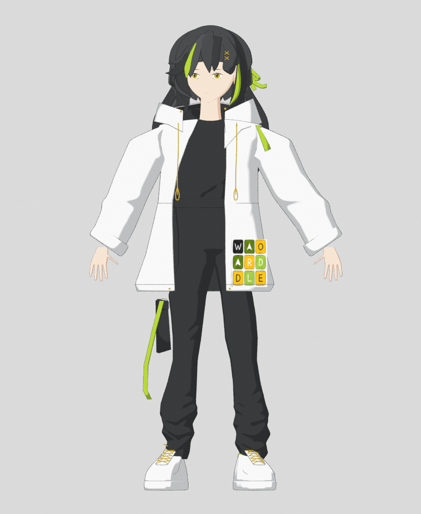
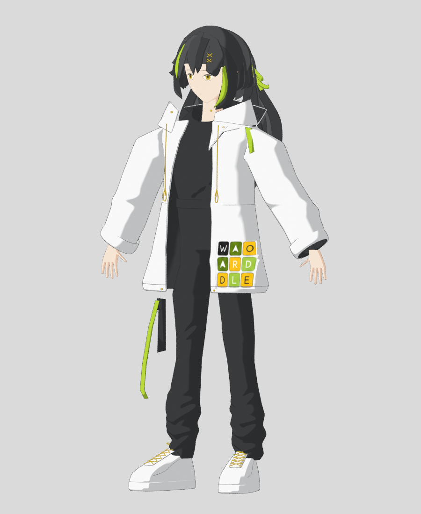
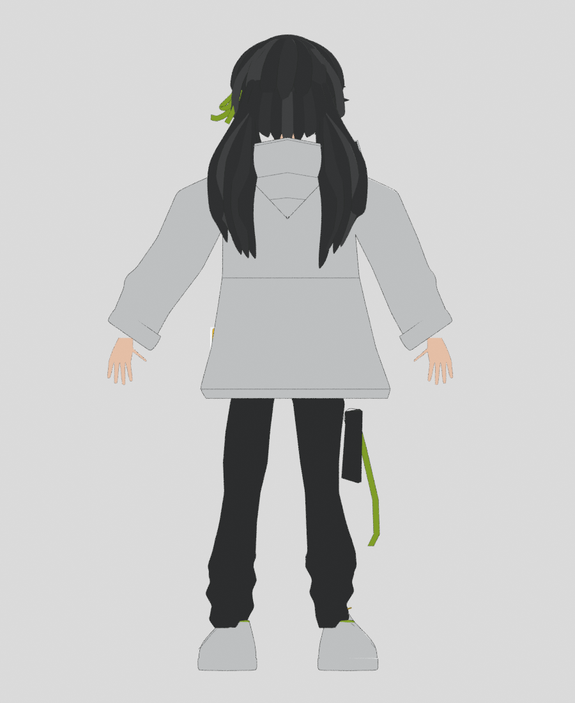

# 学盟社小小萌建模

**正在修整角色造型。以下快照记录当前制作过程。**

## 当前模型快照

以下为当前 Blender 三维工程的真实渲染快照，展示本轮制作进度。每次更新同步刷新这里的预览，点击图片可查看原尺寸。

| 正面 | 四分之三 | 背面 |
| --- | --- | --- |
|  |  |  |

[快照来源、渲染时间与文件校验](modeling/v3/previews/snapshot.json)

- [本轮制作源码与进度](modeling/v3/README.md)
- [上次暂停时的工作归档 ZIP](https://raw.githubusercontent.com/Susuny001/XiaoXiaomeng_Modeling/main/archives/xiaoxiaomeng-work-in-progress.zip)
- [上次归档说明](archives/PROGRESS.md)
- [角色设定图](assets/xiaoxiaomeng-character-model-sheet.png)

本轮工程在原归档基础上继续制作。最终以真实模型截图与原创立绘的造型对照为准，完成对照后再发布模型与预览器。
