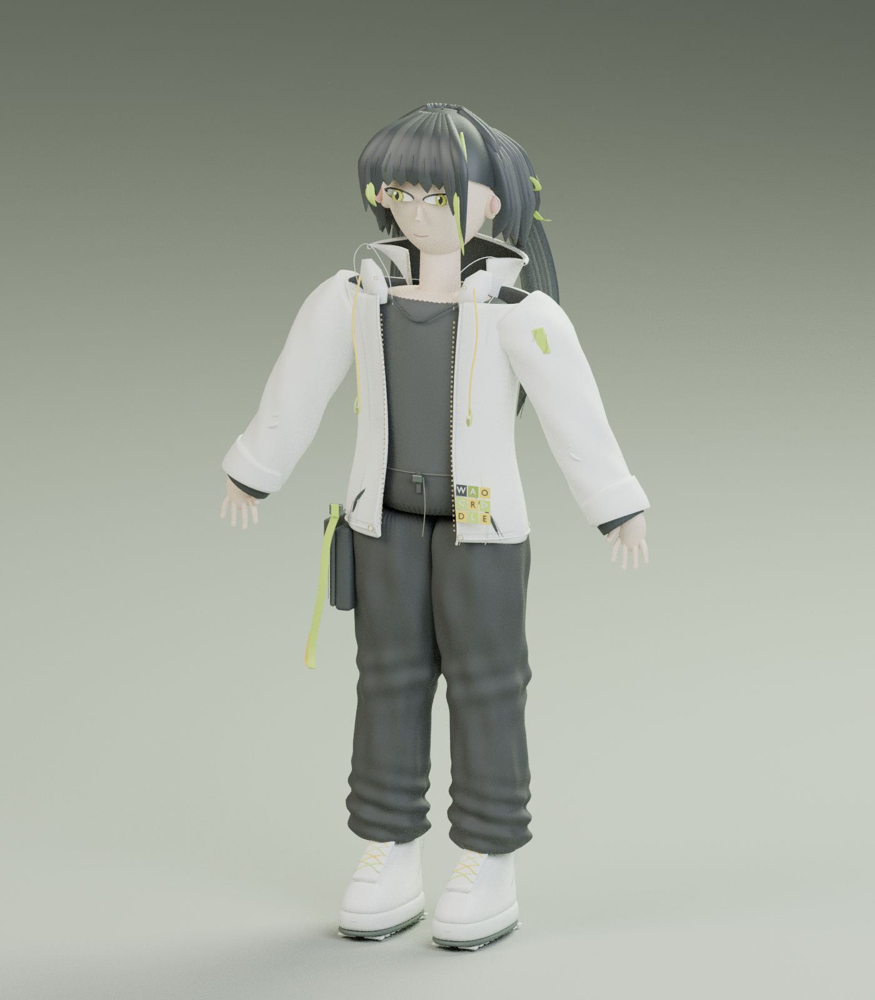

# 学盟社小小萌建模

小小萌的三维角色、分层 Blender 工程与交互预览器。

- **完整交付包：** [下载 ZIP（模型 + 可离线预览器）](https://raw.githubusercontent.com/Susuny001/XiaoXiaomeng_Modeling/main/delivery/xiaoxiaomeng-model-and-viewer.zip)
- **完整使用说明：** [DELIVERY.md](DELIVERY.md)
- **三维文件：** [GLB](models/xiaoxiaomeng.glb) · [FBX](models/xiaoxiaomeng.fbx) · [Blend](models/xiaoxiaomeng.blend)
- **角色设定图：** [PNG](assets/xiaoxiaomeng-character-model-sheet.png)
- **预览器：** 下载完整 ZIP，解压后双击 `PREVIEW.html`。模型与查看器全部内嵌，无需安装依赖。也提供 Python 本地服务器启动器。

模型含 34 根基础 FK 骨骼及分层服装、头发和鞋履。未包含表情绑定、IK、动态布料或游戏低模；详见交付说明中的适用范围。

导出 GLB 约 62.2 万三角面。GLB 格式验证为 0 错误、0 警告；GLB、FBX、Blend 均经过重新导入、尺寸、权重和膝关节变形检查。单文件预览器经过仅允许 HTML 自身请求的隔离测试，无需额外下载模型或 JavaScript。
